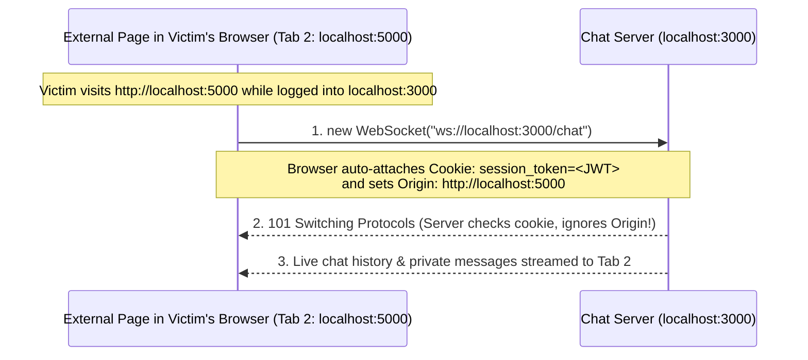
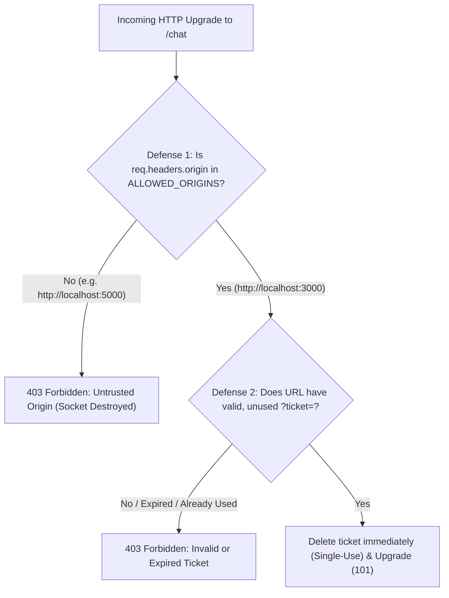

# Complete Project Guide: Workflow, Security Deep-Dive (Q&A), Code Walkthrough & 3-VM Setup

This master document covers everything about your project in four sections:
1. **Part 1: Complete End-to-End Workflow** (How the breach happens and how it is secured)
2. **Part 2: Security Deep-Dive & Answers to All Your Questions** (JWT cookies, `SameSite=Strict` vs `None`, Site vs Origin, Netlify/Public Suffix List, and raw `ws` vs Socket.IO)
3. **Part 3: How Each File Works**
4. **Part 4: Step-by-Step Guide to Deploying in 3 Virtual Machines (Host-Only Network)**

---

## Part 1: Complete End-to-End Workflow

### 1. How Normal Login & WebSocket Chat Works
```mermaid
sequenceDiagram
    participant Browser as User Browser (Tab 1: localhost:3000)
    participant ChatServer as Chat Server (localhost:3000)

    Browser->>ChatServer: 1. POST /api/login (email, password)
    ChatServer-->>Browser: 2. Set-Cookie: session_token=<JWT>; HttpOnly; SameSite=Lax
    Browser->>ChatServer: 3. GET /chat (Upgrade: websocket + Cookie: session_token)
    ChatServer-->>Browser: 4. 101 Switching Protocols (Bidirectional WebSocket Open)
```

1. **Login (`POST /api/login`):** Alice logs in on `http://localhost:3000`. The server verifies her password, signs a JWT containing `{ id, email, name }`, and sends it back inside an `httpOnly` cookie named `session_token`.
2. **Cookie Vault:** The browser stores `session_token` for `localhost`. Because `httpOnly` is `true`, JavaScript cannot read `document.cookie`.
3. **WebSocket Handshake (`ws://localhost:3000/chat`):** Every WebSocket starts as an **HTTP GET request** with an `Upgrade: websocket` header. Whenever the browser sends an HTTP request to `localhost`, it automatically attaches the `session_token` cookie.

---

### 2. How Cross-Site WebSocket Hijacking (CSWSH) Happens in Vulnerable Mode


Why does this happen?
1. **Same-Origin Policy (SOP) does NOT block WebSocket connections by default:** Standard `fetch()` calls across origins are blocked from reading responses unless the server sends `Access-Control-Allow-Origin` (CORS) headers. WebSockets were designed before modern CORS and rely on the server to validate the `Origin` header during the handshake.
2. **Raw `ws` in Node.js accepts all Origins by default:** Unlike higher-level libraries that may configure CORS, the native `ws` package in Node.js accepts connections from any origin unless the developer manually checks `req.headers.origin`.
3. **Ambient Credentials:** Because `session_token` is a cookie, the browser attaches it automatically to the `ws://localhost:3000/chat` upgrade request—even though the request was initiated by `http://localhost:5000`.

---

### 3. How the Two Defenses Stop It



1. **Defense 1 — Strict Origin Validation:**
   - The browser automatically attaches `Origin: http://localhost:5000` when Tab 2 initiates the WebSocket handshake. Client-side JavaScript is forbidden by the browser from spoofing or modifying the `Origin` header.
   - Our `server.on('upgrade')` handler checks `config.ALLOWED_ORIGINS.includes(req.headers.origin)`. If it doesn't match `http://localhost:3000`, the server writes `HTTP/1.1 403 Forbidden` and destroys the TCP socket immediately.
2. **Defense 2 — Single-Use Ephemeral Ticket (`POST /api/ws-ticket`):**
   - We stop trusting automatic cookies during the WebSocket upgrade altogether.
   - Instead, before opening the WebSocket, the legitimate frontend must call `fetch('/api/ws-ticket', { method: 'POST' })`.
   - The server verifies the user's cookie on that HTTP POST request, generates a random UUID (`crypto.randomUUID()`) valid for **15 seconds**, stores it in a `Map`, and returns `{ ticket }` as JSON.
   - **Why can't Tab 2 (`http://localhost:5000`) call `POST http://localhost:3000/api/ws-ticket` to get a ticket?** Because **`fetch()` IS strictly governed by the browser's Same-Origin Policy (SOP)**! Since `http://localhost:5000` is a different Origin from `http://localhost:3000` (different port), the browser blocks Tab 2's JavaScript from reading the JSON response containing the ticket.
   - Finally, as soon as the legitimate client connects with `ws://localhost:3000/chat?ticket=<uuid>`, the server deletes the ticket from the `Map` so it can never be reused.

---

## Part 2: Security Deep-Dive (All Your Questions Answered)

### Q1: Does the external server (port 5000) ever receive or see the user's JWT token?
**No! The external server never sees the JWT string.**
- The `session_token` cookie belongs to `localhost:3000` and is marked `httpOnly: true`.
- When the victim visits `http://localhost:5000`, the cookie is **not** sent to port `5000`, and JavaScript cannot read it via `document.cookie`.
- Instead, the JavaScript loaded from port `5000` tells **the victim's own browser** to open a WebSocket directly to `ws://localhost:3000/chat`.
- The victim's browser sends the cookie **to `localhost:3000`** (the chat server), and the chat server opens the WebSocket channel back to the tab running port `5000`'s JavaScript. The external page hijacks the **live WebSocket connection** without ever seeing the JWT token itself.

---

### Q2: If we set the JWT cookie to `SameSite=Strict`, wouldn't that stop the whole issue? Why do we still need Origin Validation and Tickets?
There are **two major reasons** why `SameSite=Strict` does NOT solve the problem on its own:

#### Reason 1: "Same-Site" is NOT the same as "Same-Origin"!
Browsers define **Site** and **Origin** very differently:

| Security Concept | What the Browser Checks | `http://localhost:3000` vs `http://localhost:5000` | `http://chat.uni.edu` vs `http://club.uni.edu` |
| :--- | :--- | :--- | :--- |
| **Same-Site** (Used by `SameSite=Strict` / `Lax` cookies) | Scheme + Root Domain (`eTLD+1`). **Ignores ports and ignores subdomains!** | **SAME SITE** (Cookie IS sent even with `SameSite=Strict`!) | **SAME SITE** (Cookie IS sent even with `SameSite=Strict`!) |
| **Same-Origin** (Used by `Origin` header & `fetch` SOP) | Scheme + **Exact Subdomain** + **Exact Port** | **CROSS-ORIGIN** (`3000` ≠ `5000`) | **CROSS-ORIGIN** (`chat` ≠ `club`) |

Because `SameSite=Strict` ignores ports and subdomains, any application running on another port (`localhost:5000`) or another subdomain of the same organization (`student-blog.university.edu` vs `hr-chat.university.edu`) is considered **Same-Site**, so the browser **still attaches `SameSite=Strict` cookies automatically!**

#### Reason 2: Real-World Apps with Separate Frontend & Backend Domains MUST Use `SameSite=None`
Whenever a web application's frontend and backend are hosted on different domains, developers **cannot** use `SameSite=Strict` or `SameSite=Lax`, because doing so would block their own frontend from sending the login cookie to their own backend!

---

### Q3: When does a real-world app need its frontend on one domain to talk to a backend on another domain (`SameSite=None; Secure`)?
1. **Separate Frontend & Backend Cloud Hosting:**
   - Frontend (React/Vue) hosted on **Vercel** or **Netlify** (`https://my-ui.vercel.app`)
   - Backend (Node.js + WebSockets) hosted on **Render**, **Railway**, or **AWS** (`https://my-api.onrender.com`)
   - Because `vercel.app` and `onrender.com` are different sites, the developer must set `SameSite=None; Secure` so the login cookie works between their frontend and backend. Once `SameSite=None` is set, **any website on the internet** will also cause the browser to attach that cookie on WebSocket upgrades unless the backend validates the `Origin` header or uses One-Time Tickets.
2. **Embeddable Customer Support Chat Widgets (Intercom, Zendesk, Crisp):**
   - An online shop (`shoe-store.com`) embeds a support chat widget hosted by `intercom.io`. For the customer's chat session cookie to work inside `shoe-store.com`, it must use `SameSite=None; Secure`.
3. **Multi-Brand Platforms Sharing One Central Backend:**
   - A company owns multiple domains (e.g., `acme-flights.com` and `acme-hotels.com`) that both connect to a single real-time backend (`wss://realtime.acme-cloud.net`).

---

### Q4: What if I deploy both my frontend (`my-front.netlify.app`) and backend (`my-back.netlify.app`) on Netlify? Are they "Same-Site"?
**No — they are treated as DIFFERENT sites (Cross-Site)!**
- Browsers maintain a security list called the **Public Suffix List (PSL)** (`publicsuffix.org`).
- Shared hosting domains like `netlify.app`, `vercel.app`, `github.io`, `onrender.com`, and `herokuapp.com` are on the Public Suffix List so that one user's project (`stranger.netlify.app`) isn't treated as the "same site" as your project (`my-front.netlify.app`).
- Therefore, the browser treats `my-front.netlify.app` and `my-back.netlify.app` as two completely separate sites, and cookies between them still require `SameSite=None; Secure`.
- Subdomains are only treated as **Same-Site** when they share a **private custom domain** that is not on the Public Suffix List (such as `front.mycompany.com` and `back.mycompany.com`).

---

## Part 3: Overview of Every File in the Project

| File Path | Role in the Project |
| :--- | :--- |
| [vm1-chat-server/config.js](file:///c:/Users/User/Desktop/Dev%20Projets/cross-site-websocket-eavedropping/vm1-chat-server/config.js) | Central settings: port `3000`, `0.0.0.0` binding, `ALLOWED_ORIGINS`, and 15-second `TICKET_TTL_MS`. |
| [vm1-chat-server/server.js](file:///c:/Users/User/Desktop/Dev%20Projets/cross-site-websocket-eavedropping/vm1-chat-server/server.js) | Express + `ws` server: login route, `/api/ws-ticket` endpoint, and the `server.on('upgrade')` security gate. |
| [vm1-chat-server/public/index.html](file:///c:/Users/User/Desktop/Dev%20Projets/cross-site-websocket-eavedropping/vm1-chat-server/public/index.html) | Chat frontend: login form, live defense mode switcher (`Vulnerable`, `Origin`, `Ticket`, `Both`), and chat box. |
| [vm2-external-server/server.js](file:///c:/Users/User/Desktop/Dev%20Projets/cross-site-websocket-eavedropping/vm2-external-server/server.js) | Zero-dependency Node HTTP server running on port `5000` to represent a separate external Origin. |
| [vm2-external-server/public/index.html](file:///c:/Users/User/Desktop/Dev%20Projets/cross-site-websocket-eavedropping/vm2-external-server/public/index.html) | Diagnostic page on port `5000` that tests cross-origin WebSocket handshakes and SOP blocking on `/api/ws-ticket`. |

---

## Part 4: Step-by-Step Guide to Implementing in Virtual Machines

You can run this project either on a **single machine** using `localhost:3000` and `localhost:5000`, OR across **3 independent Virtual Machines** in VirtualBox / VMware using **Host-Only Network Mode**.

### Step 1: Create the Host-Only Network in VirtualBox / VMware
1. In **VirtualBox**, open **File → Tools → Network Manager** (or **Host Network Manager**).
2. Create or verify a Host-Only adapter (usually named `vboxnet0` or `VirtualBox Host-Only Ethernet Adapter`) with:
   - **IPv4 Address:** `192.168.56.1`
   - **IPv4 Network Mask:** `255.255.255.0`
3. For **all 3 VMs** (VM 1, VM 2, VM 3), open **VM Settings → Network → Adapter 1** and set:
   - **Attached to:** `Host-only Adapter`
   - **Name:** `vboxnet0` (or `VirtualBox Host-Only Ethernet Adapter`)

---

### Step 2: Assign Static IPs Inside Each VM
Assign the following static IPs on the Host-Only network interface inside each VM:
- **VM 1 (Chat Server):** `192.168.56.10`
- **VM 2 (External Origin Server):** `192.168.56.20`
- **VM 3 (Client with Web Browser):** `192.168.56.30`

*(On Ubuntu/Debian Linux VMs, you can assign the IP temporarily for your lab session with one command:)*
```bash
# On VM 1:
sudo ip addr add 192.168.56.10/24 dev enp0s3

# On VM 2:
sudo ip addr add 192.168.56.20/24 dev enp0s3

# On VM 3:
sudo ip addr add 192.168.56.30/24 dev enp0s3
```
*(Replace `enp0s3` with your interface name from `ip a` if different. Test connectivity by running `ping 192.168.56.10` and `ping 192.168.56.20` from VM 3.)*

---

### Step 3: How to Keep Using `localhost` on VM 3 via SSH Port Forwarding (No Domain Names Needed!)
Since you want to use **only `localhost:3000` and `localhost:5000`** in the browser without custom domain names:

On **VM 3 (Client VM)**, open a terminal and forward port `3000` to VM 1 and port `5000` to VM 2 over the Host-Only network:
```bash
# Forward VM 3's localhost:3000 -> VM 1 (192.168.56.10:3000)
ssh -L 3000:127.0.0.1:3000 user@192.168.56.10 -N &

# Forward VM 3's localhost:5000 -> VM 2 (192.168.56.20:5000)
ssh -L 5000:127.0.0.1:5000 user@192.168.56.20 -N &
```
> [!TIP]
> **Why this is awesome for your 3-VM demo:**
> - **VM 1** physically runs the Chat Server on `192.168.56.10:3000`.
> - **VM 2** physically runs the External Server on `192.168.56.20:5000`.
> - **VM 3's browser** simply visits `http://localhost:3000` and `http://localhost:5000`—so you don't need `/etc/hosts` domain names or SSL certificates, while all traffic actually travels across the Host-Only network between the 3 VMs!

---

### Step 4: Copy & Start the Servers on VM 1 and VM 2

1. **On VM 1 (`192.168.56.10`):**
   Copy the `vm1-chat-server` folder to VM 1 and run:
   ```bash
   cd vm1-chat-server
   npm install
   npm start
   ```
   *(Output: `Chat Server listening on http://localhost:3000 (mode: vulnerable)`)*

2. **On VM 2 (`192.168.56.20`):**
   Copy the `vm2-external-server` folder to VM 2 and run:
   ```bash
   cd vm2-external-server
   node server.js
   ```
   *(Output: `External Origin Diagnostic Server listening on http://localhost:5000`)*

---

### Step 5: Perform the Live Demonstration on VM 3
Open the web browser on **VM 3**:

1. **Log in to the Chat App (Tab 1):**
   - Go to `http://localhost:3000`.
   - Log in with `alice@example.com` and `password123`.
   - Send a test chat message (`"Hello from Alice"`).
2. **Open the External Origin Page (Tab 2):**
   - Open a second tab to `http://localhost:5000`.
3. **Demo 1 — Vulnerable Mode:**
   - Make sure `1. Vulnerable (Cookie Only)` is active in Tab 1.
   - In Tab 2 (`localhost:5000`), click **1. Test Cross-Origin WS Handshake**.
   - Show that the connection succeeds (`101 Switching Protocols`) and receives Alice's session and live chat messages.
4. **Demo 2 — Origin Validation Defense:**
   - In Tab 1 (`localhost:3000`), click **2. Origin Validation**.
   - In Tab 2 (`localhost:5000`), click **1. Test Cross-Origin WS Handshake**.
   - Show that the server immediately rejects Tab 2 (`403 Forbidden: Untrusted Origin`), while Tab 1 stays connected.
5. **Demo 3 — One-Time Ticket Defense:**
   - In Tab 1 (`localhost:3000`), click **3. One-Time Ticket**. Point out the status bar showing `ws://localhost:3000/chat?ticket=<uuid>`.
   - In Tab 2 (`localhost:5000`), click **2. Test Cross-Origin Ticket Fetch (SOP Test)** → Show that the Same-Origin Policy blocks Tab 2 from reading `/api/ws-ticket`.
   - In Tab 2 (`localhost:5000`), click **1. Test Cross-Origin WS Handshake** → Show that the handshake is rejected because Tab 2 has no valid ticket.
6. **Demo 4 — Both Defenses Combined:**
   - In Tab 1 (`localhost:3000`), click **4. Both (Origin + Ticket)** to demonstrate defense-in-depth.
