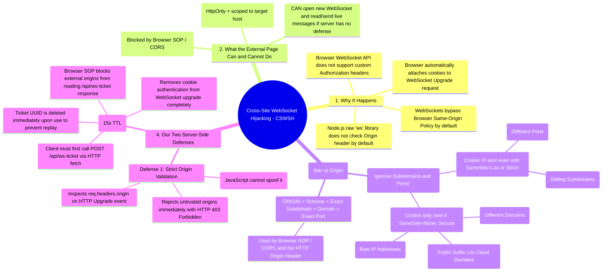
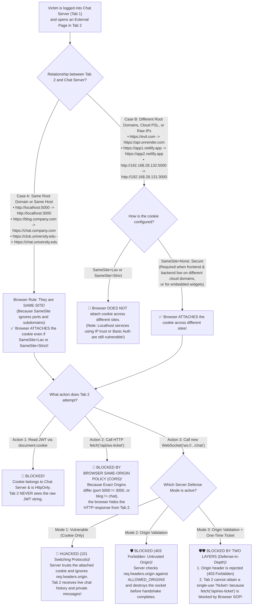
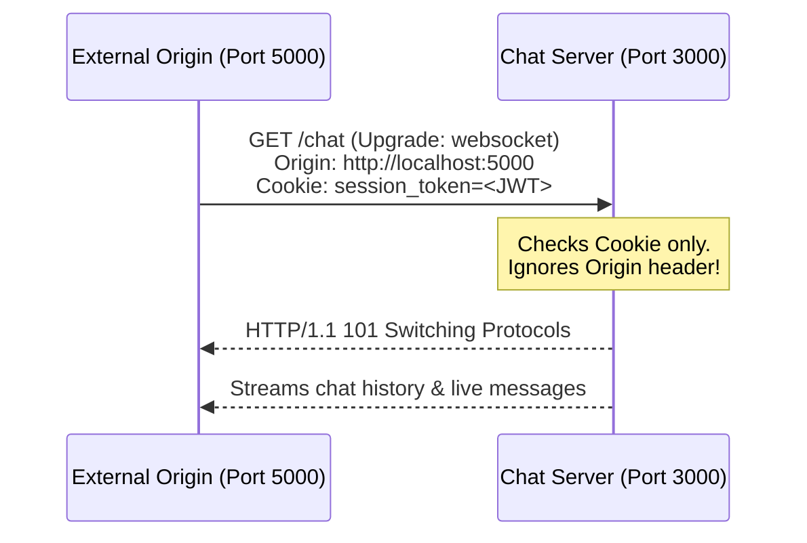
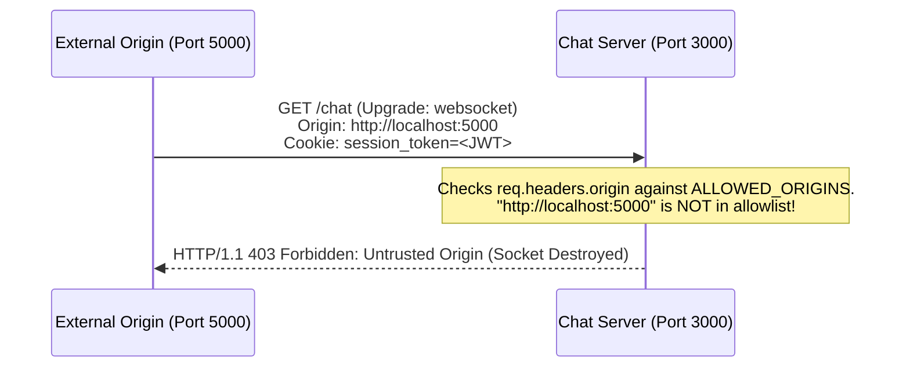
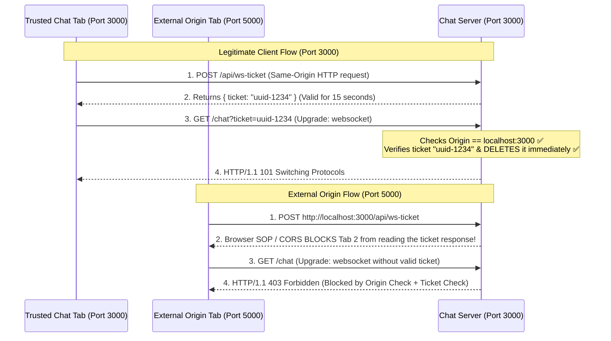

# Cross-Site WebSocket Hijacking (CSWSH) & Real-Time Defense Lab
### Using Strict Origin Validation and Single-Use Ephemeral Tickets

Welcome! This repository demonstrates **Cross-Site WebSocket Hijacking (CSWSH)**—a critical web security vulnerability in real-time WebSocket applications—and shows how to secure WebSocket servers using **Origin Enforcement** and the **Single-Use Ephemeral Ticket Pattern**.

This guide is written so that **anyone visiting this repository for the first time** can understand the problem, the browser mechanics, every edge case, and the code from scratch.

---

> [!IMPORTANT]
> ### Crucial Lab Note: `SameSite=None`, `secure: false`, and Browser Settings for Plain HTTP VM Testing
>
> When testing across **two different Virtual Machine IP addresses** over plain HTTP (for example, `http://192.168.28.131:3000` and `http://192.168.28.132:5000` without SSL/HTTPS certificates):
>
> 1. **What `SameSite=None` does:**
>    Because two raw IP addresses (`192.168.28.131` and `192.168.28.132`) have no shared domain name, the browser treats them as **two completely different websites (Cross-Site)**. For the browser to attach the login cookie across two different sites/IPs, the cookie must use `sameSite: 'None'`.
> 2. **What `secure: true` vs `secure: false` does:**
>    - **`secure: true`** tells the browser: *"ONLY save and send this cookie over encrypted `https://` (or `wss://`) connections!"* (with a built-in exception for `http://localhost`). If you set `secure: true` while visiting a plain HTTP IP address like `http://192.168.28.131:3000`, the browser **refuses to save the cookie at all**, and even normal login breaks!
>    - **`secure: false`** allows the browser to save and send the cookie over plain **`http://`** and **`ws://`** in a local VM lab without needing HTTPS certificates.
> 3. **Required One-Time Browser Setting for Plain HTTP VM Lab:**
>    By default, modern browsers block `SameSite=None` unless `secure: true` (`https://`) is used. To allow `SameSite=None` with `secure: false` over plain `http://192.168.x.x` in your VM browser:
>    - **In Firefox (e.g., Kali Linux / Ubuntu VM):**
>      1. Open a new tab and go to **`about:config`** (click *Accept the Risk and Continue*).
>      2. Search for **`network.cookie.sameSite.noneRequiresSecure`** and double-click it to set it to **`false`**.
>      3. Search for **`network.cookie.cookieBehavior`** and change its value from `5` to **`0`** (this disables Firefox's "Total Cookie Protection" so cross-IP cookies work in both Normal and Private Browsing windows).
>    - **In Chrome / Chromium / Edge / Brave:**
>      1. Open **`chrome://flags/#unsafely-treat-insecure-origin-as-secure`**.
>      2. Enter your Chat Server URL (e.g. `http://192.168.28.131:3000`), set to **Enabled**, and relaunch.
>    - *(Note: If you run both servers on the same machine via `http://localhost:3000` and `http://localhost:5000`, no browser setting change is needed because `localhost` is already treated as Same-Site and Secure by default.)*

---

## 1. The Big Picture: Why HTTP Is Safe by Default While WebSockets Are Vulnerable by Default!

### 🚨 First: The Attacker NEVER Has the User's JWT Token!
A common question is: *"If the attacker already has the user's token, why would they eavesdrop on WebSockets instead of just logging in or making HTTP requests?"*

**The answer: The attacker NEVER gets the JWT token, and CANNOT make HTTP requests!**
- When Alice logs into the Chat Server (`https://192.168.28.131:3000`), her token is stored in an `HttpOnly: true` cookie locked to `.131:3000`.
- When Alice opens the Attacker's page (`https://192.168.28.132:5000`) in Tab 2 on her own computer:
  - If the Attacker checks `document.cookie` on `.132:5000`, it prints **`""` (EMPTY!)**. The Attacker never sees the JWT string and can never log in as Alice!
  - So the Attacker's only option is to write JavaScript on `.132:5000` that tells **Alice's own browser** to send requests to `.131:3000` (where Alice's browser will attach her cookie automatically).

---

### 💡 Why Does the Browser Block HTTP `fetch()` Automatically, While Allowing `new WebSocket()`?

Look at `app.get('/api/me')` in our own [`vm1-chat-server/server.js`](vm1-chat-server/server.js):
```javascript
app.get('/api/me', (req, res) => {
  const user = getUserFromToken(req.cookies[config.COOKIE_NAME]);
  res.json({ user, mode: defenseMode });
});
```
Notice something? **We wrote ZERO Origin checks inside `app.get('/api/me')`!**

Yet look at what happens when the Attacker's page (`.132:5000`) tries **HTTP `fetch('/api/me')`** vs. **`new WebSocket('/chat')`**:

1. **In Normal HTTP (`fetch`) — "Secure by Default" (Browser Protects You Automatically!):**
   - When `.132:5000` calls `fetch('https://192.168.28.131:3000/api/me', { credentials: 'include' })`, Alice's browser attaches her cookie, and **the server DOES think it's Alice and DOES send back Alice's JSON data!**
   - **Why can't the Attacker read it?** Because when the HTTP response arrives at Alice's browser, **the BROWSER ITSELF throws the response in the trash!**
   - The browser prints in red: `Blocked by CORS policy: No 'Access-Control-Allow-Origin' header is present`.
   - Unless the server developer explicitly added `Access-Control-Allow-Origin: https://192.168.28.132:5000`, **the browser blocks cross-origin HTTP reads automatically—even when the developer wrote zero Origin checks!**

2. **In WebSockets (`new WebSocket`) — "Insecure by Default" (Neither the Browser Nor `ws` Protects You!):**
   - When engineers designed the **WebSocket standard (RFC 6455)**, they decided:
     > *"For WebSockets, **the browser will NOT block cross-origin connections** and will NOT check `Access-Control-Allow-Origin`! Instead, the browser will only attach the `Origin` header (`Origin: https://192.168.28.132:5000`) and leave it 100% up to the **backend server** to check it!"*
   - AND then, backend WebSocket libraries (like `ws` in Node.js, `websockets` in Python, etc.) **also** did not check the `Origin` header by default!

### Side-by-Side Comparison (The Core Message of This Project):

| If a Developer Writes ZERO Origin Code... | Normal HTTP (`fetch`) | WebSockets (`new WebSocket`) |
| :--- | :--- | :--- |
| **Does the Attacker ever see the JWT token string?** | ❌ **No** (`document.cookie` is empty / `HttpOnly`) | ❌ **No** (`document.cookie` is empty / `HttpOnly`) |
| **Does the server think it's the real user and respond?** | ✅ **Yes** (Server sees the attached cookie and responds) | ✅ **Yes** (Server sees the attached cookie and upgrades) |
| **What does the BROWSER do by default?** | 🛡️ **BLOCKS IT AUTOMATICALLY!**<br/>(Throws the response away unless `Access-Control-Allow-Origin` is present) | 🚨 **ALLOWS IT AUTOMATICALLY!**<br/>(Browser assumes the server checked `req.headers.origin`!) |
| **What does Node.js (`express` vs `ws`) do by default?** | 🛡️ **Safe by default** (Sends no CORS headers unless you add them) | 🚨 **Vulnerable by default** (`ws` accepts all Origins unless you write `server.on('upgrade')` checks!) |

> **The 1-Sentence Takeaway:**
> **In HTTP (`fetch`), if a developer does nothing, the browser BLOCKS cross-origin access by default. In WebSockets (`ws`), if a developer does nothing, both the browser and the server ALLOW cross-origin access by default—which is why developers must manually implement Origin Validation and One-Time Tickets!**

---

## 2. Master Mindmap of the Entire Security Landscape



---

## 3. Complete Decision Flowchart (Every Edge Case Explained)

Follow this chart from top to bottom to see how the browser and server behave in **every possible scenario**:



---

## 4. Critical Concept: "Same-Site" vs "Same-Origin" (Why `SameSite=Strict` Is Not Enough)

One of the most common misunderstandings in web security is thinking that **Site** and **Origin** mean the same thing. **They do not!**

| Feature | **SITE** (Used by `SameSite` Cookies) | **ORIGIN** (Used by `fetch` SOP & `Origin` Header) |
| :--- | :--- | :--- |
| **What parts of the URL are checked?** | `scheme` + `root domain` **ONLY** | `scheme` + **exact subdomain** + `root domain` + **exact port** |
| **Are ports checked?** | ❌ **NO** (Port `3000` and Port `5000` are the **Same Site**) | ✅ **YES** (Port `3000` and Port `5000` are **Different Origins**) |
| **Are subdomains checked?** | ❌ **NO** (`blog.company.com` and `chat.company.com` are the **Same Site**) | ✅ **YES** (`blog.company.com` and `chat.company.com` are **Different Origins**) |
| **What about shared cloud domains (`*.netlify.app`, `*.vercel.app`, `*.azurewebsites.net`)?** | Listed on the **Public Suffix List (PSL)**, so `a.netlify.app` and `b.netlify.app` are treated as **Different Sites** | Treated as **Different Origins** |
| **What about two raw IP addresses (`192.168.28.131` vs `192.168.28.132`)?** | Treated as **Different Sites** (no shared root domain) | Treated as **Different Origins** |

### Why This Matters:
Suppose a company or university hosts its private chat on `chat.company.com` (even with `SameSite=Strict`!) and has a public blog or student page on `blog.company.com`:
1. **Does `blog.company.com` have the user's token?** **No.**
2. **Can `blog.company.com` use `fetch("https://chat.company.com/api/...")`?** **No** — blocked by **Origin** check (Same-Origin Policy).
3. **Can `blog.company.com` hijack `new WebSocket("wss://chat.company.com/chat")`?** **YES!** Because `blog.company.com` and `chat.company.com` share `.company.com` (**Same-Site**), the browser attaches the cookie even when `SameSite=Strict` is set!

---

## 5. How the 3 Modes Work in Code (Step-by-Step)

Our server ([`vm1-chat-server/server.js`](vm1-chat-server/server.js)) lets you switch between **3 modes** live from the browser UI:

### Mode 1: `1. Vulnerable (Cookie Only)`

- **Code in `server.js`:** Parses `req.headers.cookie`, verifies the JWT, and calls `wss.handleUpgrade(...)` without checking `req.headers.origin`.

---

### Mode 2: `2. Origin Validation`

- **Code in `server.js`:**
  ```javascript
  const origin = req.headers.origin;
  if (!origin || !config.ALLOWED_ORIGINS.includes(origin)) {
    return rejectUpgrade(socket, 403, 'Forbidden: Untrusted Origin');
  }
  ```
- **Why the attacker cannot bypass this from a browser:** The `Origin` header is set by the browser engine itself and is a forbidden header in JavaScript—client-side scripts cannot spoof or remove it.

---

### Mode 3: `3. Origin + One-Time Ticket` (Defense-in-Depth)
Why add a **One-Time Ticket** on top of Origin Validation?
1. In production, reverse proxies (like Nginx or AWS Load Balancers) are sometimes misconfigured to overwrite the `Origin` header (`proxy_set_header Origin $host`), accidentally bypassing Origin Validation.
2. Relying on automatic cookies ("ambient credentials") for WebSocket upgrades means the server isn't verifying that the page opening the WebSocket can actually pass the browser's **Same-Origin Policy (SOP)**.



- **How it works in code:**
  1. **Ticket Endpoint (`POST /api/ws-ticket` in `server.js`):** Verifies the user's JWT cookie on a normal HTTP POST request, generates a random `crypto.randomUUID()` ticket valid for **15 seconds**, stores `ticket -> { user, expiresAt }` in a server-side `Map`, and returns `{ ticket }`.
  2. **Why external origins cannot get a ticket:** Because `POST /api/ws-ticket` is a normal HTTP request, the browser's **Same-Origin Policy (SOP)** blocks any external origin (`localhost:5000` or `blog.company.com`) from reading the JSON response!
  3. **Single-Use Burning on Upgrade:** When the client connects to `ws://localhost:3000/chat?ticket=<uuid>`, `server.on('upgrade')` first validates `req.headers.origin`, then looks up the ticket in the `Map`, **immediately deletes it (`tickets.delete(ticketId)`)** so it can never be replayed, checks that `Date.now() <= record.expiresAt`, and upgrades the connection without using cookies at all.

---

## 6. Frequently Asked Questions (Reviewer & Exam Q&A)

<details>
<summary><strong>Q1: Why don't developers just send an <code>Authorization: Bearer &lt;JWT&gt;</code> header on WebSockets instead of using cookies?</strong></summary>

Because the browser's built-in JavaScript `new WebSocket(url)` API **does not have a `headers` option**! Unlike `fetch(url, { headers: { Authorization: '...' } })`, browsers do not allow JavaScript to attach custom HTTP headers like `Authorization` to a WebSocket handshake. That is why developers fall back to cookies—or use the **One-Time Ticket pattern** in the URL query string (`?ticket=<uuid>`).
</details>

<details>
<summary><strong>Q2: Why doesn't Express <code>app.use(cors(...))</code> protect WebSockets automatically?</strong></summary>

1. Express middleware (`app.use(cors(...))`) only runs on standard HTTP routes (`GET`, `POST`, etc.)—it **never runs** on raw HTTP `upgrade` events (`server.on('upgrade')`).
2. Browsers do **not** perform CORS preflight (`OPTIONS`) checks or enforce `Access-Control-Allow-Origin` on `new WebSocket()` connections.
</details>

<details>
<summary><strong>Q3: What if a service uses <code>SameSite=Strict</code> on its cookies—is there still any way a WebSocket can be hijacked while HTTP <code>fetch()</code> is blocked?</strong></summary>

Yes, in **two major ways**:
1. **Same-Site Subdomains or Ports:** As shown in the table above, `SameSite=Strict` only checks the root domain (`*.company.com` or `localhost`). Any compromised or user-hosted sibling subdomain (`blog.company.com`) or different port (`localhost:5000`) is considered **Same-Site** by the browser, so `SameSite=Strict` cookies are **still sent** on WebSocket upgrades, while `fetch()` is blocked by the Same-Origin Policy!
2. **Non-Cookie Ambient Auth / Localhost Services:** `SameSite=Strict` only applies to cookies. Localhost developer tools/daemons (`ws://localhost:port`) that trust local connections, or intranet apps using HTTP Basic Auth / Windows Integrated Auth (NTLM/Kerberos) or client TLS certificates, still allow cross-origin WebSocket connections while blocking `fetch()` via SOP.
</details>

---

## 7. Project Structure

```text
cross-site-websocket-eavedropping/
├── README.md                              # Complete project documentation & visual mindmap (this file)
├── USER_GUIDE.md                          # Step-by-step usage guide & all VM/browser adjustments explained
├── visual-mindmap.html                    # Interactive visual cheat-sheet (open in any browser!)
├── SECURITY_CONCEPTS_AND_MINDMAP.md       # Quick revision notes
├── BEYOND_COOKIES_BASIC_AUTH_AND_NTLM.md  # Deep-dive: HTTP Basic Auth, Windows NTLM/Kerberos & Localhost CSWSH
├── CODE_AND_LAB_GUIDE.md                  # Code walkthrough & 3-VM Host-Only setup guide
├── vm1-chat-server/                   # Trusted Chat Application (Port 3000)
│   ├── package.json
│   ├── .env.example
│   ├── config.js                      # Server & defense configuration
│   ├── server.js                      # Express + ws backend with 3 switchable modes
│   └── public/
│       └── index.html                 # Chat UI + live Defense Mode switcher
└── vm2-external-server/               # External Origin Diagnostic Server (Port 5000)
    ├── .env.example
    ├── server.js                      # Zero-dependency HTTP server on port 5000
    └── public/
        └── index.html                 # Diagnostic client testing cross-origin WS & SOP
```

---

## 8. Quick Start (Run Locally or in VMs)

### 1. Start the Chat Server (Port 3000)
```bash
cd vm1-chat-server
npm install
npm start
```

### 2. Start the External Origin Diagnostic Server (Port 5000)
```bash
cd vm2-external-server
node server.js
```

### 3. Test All 3 Modes in Your Browser
1. Open **`http://localhost:3000`** in Tab 1 and log in (`alice@example.com` / `password123`).
2. Open **`http://localhost:5000`** in Tab 2.
3. Switch between **Mode 1 (Vulnerable)**, **Mode 2 (Origin Validation)**, and **Mode 3 (Origin + One-Time Ticket)** in Tab 1, and click **1. Test Cross-Origin WS Handshake** and **2. Test Cross-Origin Ticket Fetch (SOP Test)** in Tab 2 to observe each defense in action!
