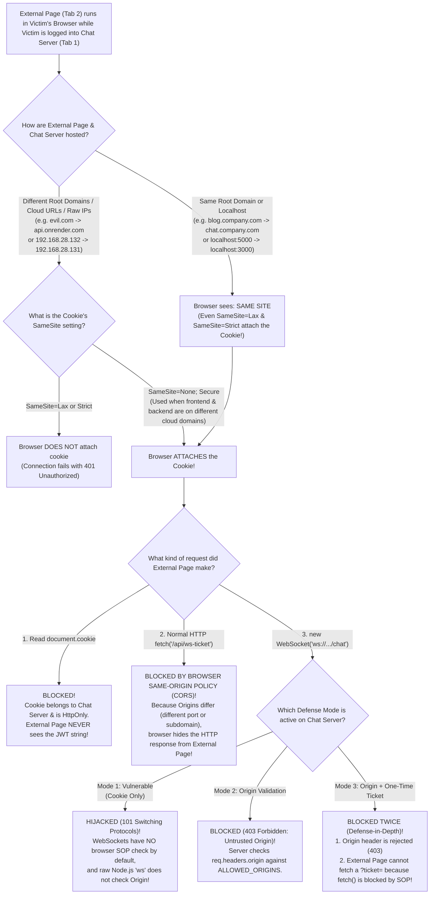

# Visual Cheat-Sheet & Mindmap: Cookies, Origins, WebSockets & Defenses

This file is designed so you can read it in 5 minutes before any presentation or exam and immediately remember **how everything works**, **all edge cases**, and **how our 3 modes are implemented in code**.

---

## 1. The Golden Rule (Remember This One Table!)

Whenever Page A tries to talk to Server B, the browser asks **two completely different questions**:
1. **Question 1 (Cookie Check — `SameSite`):** *"Should I attach the user's cookie to this request?"* → Checks **SITE** (ignores ports & subdomains!).
2. **Question 2 (Read Permission — `Same-Origin Policy / CORS`):** *"Should I let Page A read the response?"* → Checks **EXACT ORIGIN** (`scheme + subdomain + domain + port`) — **EXCEPT WebSockets, which skip Question 2!**

| Scenario (Page A → Server B) | Are They Same-Site? (Cookie Sent?) | Are They Same-Origin? (`fetch` Allowed?) | Can `new WebSocket()` Hijack It (If No Defense)? |
| :--- | :--- | :--- | :--- |
| **1. Different Ports on Same Machine**<br>`http://localhost:5000` → `http://localhost:3000` | **YES (Same-Site)**<br>Cookie IS sent even with `SameSite=Lax` or `Strict`! | **NO (Cross-Origin)**<br>`fetch()` is **BLOCKED** by browser SOP! | **YES! Vulnerable to CSWSH!**<br>(Cookie is sent + WS skips SOP!) |
| **2. Different Subdomains of a Company/Uni**<br>`https://blog.company.com` → `https://chat.company.com` | **YES (Same-Site)**<br>Cookie IS sent even with `SameSite=Lax` or `Strict`! | **NO (Cross-Origin)**<br>`fetch()` is **BLOCKED** by browser SOP! | **YES! Vulnerable to CSWSH!**<br>(Cookie is sent + WS skips SOP!) |
| **3. Cloud Shared Domains (Public Suffix List)**<br>`app1.netlify.app` → `app2.netlify.app`<br>`front.azurewebsites.net` → `back.azurewebsites.net` | **NO (Cross-Site!)**<br>Cookie ONLY sent if `SameSite=None; Secure` | **NO (Cross-Origin)**<br>`fetch()` is **BLOCKED** unless CORS allows it | **YES if `SameSite=None; Secure` is used!**<br>(No if `SameSite=Lax`) |
| **4. Totally Different Domains / Raw IPs**<br>`evil.com` → `api.onrender.com`<br>`192.168.28.132` → `192.168.28.131` | **NO (Cross-Site!)**<br>Cookie ONLY sent if `SameSite=None; Secure` | **NO (Cross-Origin)**<br>`fetch()` is **BLOCKED** by browser SOP! | **YES if `SameSite=None; Secure` is used!**<br>(No if `SameSite=Lax`) |

---

## 2. Master Visual Decision Tree (All Edge Cases)



---

## 3. Why the External Page (`blog.company.com` or `localhost:5000`) Can Hijack WebSockets WITHOUT Ever Having the Token

This is the concept that confuses almost everyone—here is the simple 3-step truth:

1. **Does `blog.company.com` (or `localhost:5000`) ever get the user's JWT token?**
   - **NO!** The cookie is locked to `chat.company.com` (or `localhost:3000`) and has `httpOnly: true`. The external page never sees the JWT token string.
2. **Then why can't `blog.company.com` just use `fetch("https://chat.company.com/api/messages")`?**
   - When `blog.company.com` runs `fetch("https://chat.company.com/api/messages", { credentials: "include" })`, the victim's browser **does** send the cookie to `chat.company.com`, **BUT** when the data comes back, the browser checks the **Exact Origin**:
     - Request came from: `https://blog.company.com`
     - Target is: `https://chat.company.com`
   - Because `blog` ≠ `chat`, the browser's **Same-Origin Policy (SOP)** blocks `blog.company.com` from reading the response!
3. **Why DOES `new WebSocket("wss://chat.company.com/chat")` work when `fetch()` failed?**
   - Because **the browser's Same-Origin Policy does NOT apply to `new WebSocket()`!**
   - The victim's browser attaches the `chat.company.com` cookie (because both share `.company.com`), and if the server doesn't check `req.headers.origin`, the server opens a two-way pipe directly to the JavaScript running on `blog.company.com`!

---

## 4. How We Implemented the 3 Modes in Our Project Code

In our project, we have **3 modes** in [vm1-chat-server/server.js](file:///c:/Users/User/Desktop/Dev%20Projets/cross-site-websocket-eavedropping/vm1-chat-server/server.js):
1. `vulnerable` — **1. Vulnerable (Cookie Only)**
2. `origin` — **2. Origin Validation**
3. `both` — **3. Origin + One-Time Ticket**

Here is how each one works in the code:

---

### Mode 1: Vulnerable Mode (`defenseMode === 'vulnerable'`)
When the browser runs `new WebSocket("ws://localhost:3000/chat")`, Node.js fires `server.on('upgrade', (req, socket, head) => { ... })`.

In **Vulnerable Mode**, the server only runs this code ([server.js](file:///c:/Users/User/Desktop/Dev%20Projets/cross-site-websocket-eavedropping/vm1-chat-server/server.js#L162-L171)):
```javascript
const cookies = parseCookies(req.headers.cookie);
authenticatedUser = getUserFromToken(cookies[config.COOKIE_NAME]);

if (!authenticatedUser) {
  return rejectUpgrade(socket, 401, 'Unauthorized: Missing or Invalid Cookie');
}
```
- **What it checks:** Only whether the browser attached a valid `session_token` cookie.
- **Why it is vulnerable:** It never checks `req.headers.origin`, so a connection initiated from `http://localhost:5000` (or `http://192.168.28.132:5000`) with the victim's cookie is accepted with `101 Switching Protocols`.

---

### Mode 2: Origin Validation (`defenseMode === 'origin'`)
When you click **2. Origin Validation**, `requiresOriginCheck` becomes `true` ([server.js](file:///c:/Users/User/Desktop/Dev%20Projets/cross-site-websocket-eavedropping/vm1-chat-server/server.js#L134-L141)):

```javascript
const requiresOriginCheck = defenseMode === 'origin' || defenseMode === 'both';

if (requiresOriginCheck) {
  const origin = req.headers.origin;
  if (!origin || !config.ALLOWED_ORIGINS.includes(origin)) {
    return rejectUpgrade(socket, 403, 'Forbidden: Untrusted Origin');
  }
}
```
- **How it works:**
  1. Every browser automatically stamps the `Origin` HTTP header on a WebSocket upgrade request with the exact page that called `new WebSocket(...)` (for example, `Origin: http://localhost:5000`).
  2. Browser security **forbids JavaScript from modifying or faking the `Origin` header**.
  3. The server checks if `req.headers.origin` is inside `config.ALLOWED_ORIGINS` (`['http://localhost:3000', 'http://192.168.28.131:3000']`).
  4. If it comes from port `5000` or `.132`, the server immediately writes `HTTP/1.1 403 Forbidden` to the TCP socket and destroys it (`socket.destroy()`).

---

### Mode 3: Origin Validation + One-Time Ticket (`defenseMode === 'both'`)
When you click **3. Origin + One-Time Ticket**, **both** `requiresOriginCheck` and `requiresTicketCheck` become `true`.

This mode combines **Origin Validation** with a **Single-Use Cryptographic Ticket** in 3 steps:

#### Step A: Frontend Requests a Ticket via Standard HTTP (`vm1-chat-server/public/index.html`)
Before opening the WebSocket, the legitimate chat page calls `POST /api/ws-ticket` ([index.html](file:///c:/Users/User/Desktop/Dev%20Projets/cross-site-websocket-eavedropping/vm1-chat-server/public/index.html#L114-L124)):
```javascript
if (currentMode === 'both') {
  const res = await fetch('/api/ws-ticket', { method: 'POST' });
  const data = await res.json();
  wsUrl += `?ticket=${encodeURIComponent(data.ticket)}`;
}
ws = new WebSocket(wsUrl);
```
- **Why can the legitimate page (`localhost:3000`) do this, while the external page (`localhost:5000`) CANNOT?**
  Because `fetch('/api/ws-ticket')` is a normal HTTP request! The browser's **Same-Origin Policy (SOP)** allows `localhost:3000` to read the JSON response from `localhost:3000`, but **blocks** `localhost:5000` from reading it!

#### Step B: Backend Generates a 15-Second UUID Ticket (`vm1-chat-server/server.js`)
In [server.js](file:///c:/Users/User/Desktop/Dev%20Projets/cross-site-websocket-eavedropping/vm1-chat-server/server.js#L105-L120):
```javascript
app.post('/api/ws-ticket', (req, res) => {
  const user = getUserFromToken(req.cookies[config.COOKIE_NAME]);
  if (!user) {
    return res.status(401).json({ error: 'Authentication required' });
  }

  const ticket = crypto.randomUUID();
  tickets.set(ticket, {
    user: { id: user.id, email: user.email, name: user.name },
    expiresAt: Date.now() + config.TICKET_TTL_MS // 15 seconds
  });

  res.json({ ticket, expiresInSeconds: config.TICKET_TTL_MS / 1000 });
});
```
- The server verifies the user's JWT cookie on this SOP-protected HTTP route, generates a random UUID (`e.g. 9b1deb4d-3b7d-4bad-9bdd-2b0d7b3dcb6d`), saves it in the `tickets` `Map` with a 15-second expiration, and returns it.

#### Step C: WebSocket Upgrade Checks Origin AND Burns the Ticket (`vm1-chat-server/server.js`)
When the browser connects to `ws://localhost:3000/chat?ticket=<uuid>`, `server.on('upgrade')` runs **both** checks ([server.js](file:///c:/Users/User/Desktop/Dev%20Projets/cross-site-websocket-eavedropping/vm1-chat-server/server.js#L134-L161)):
1. **Check 1 (Origin Check):** Verifies `req.headers.origin` is in `ALLOWED_ORIGINS`. If not → `403 Forbidden: Untrusted Origin`.
2. **Check 2 (Ticket Check — Ignores Cookies!):**
   ```javascript
   if (requiresTicketCheck) {
     const ticketId = requestUrl.searchParams.get('ticket');
     const record = tickets.get(ticketId);

     // Immediately delete (burn) the ticket so it can NEVER be used a second time
     if (ticketId) {
       tickets.delete(ticketId);
     }

     if (!record || Date.now() > record.expiresAt) {
       return rejectUpgrade(socket, 403, 'Forbidden: Invalid or Expired Ticket');
     }

     authenticatedUser = record.user;
   }
   ```
   - Notice that in Mode 3 (`both`), the WebSocket upgrade handler **does not use `req.headers.cookie` at all**!
   - It extracts `?ticket=<uuid>` from the URL, looks it up in the `tickets` Map, **immediately deletes it** (`tickets.delete(ticketId)`) so an attacker cannot replay it, verifies it hasn't expired (15 seconds), and binds the WebSocket to `record.user`.
